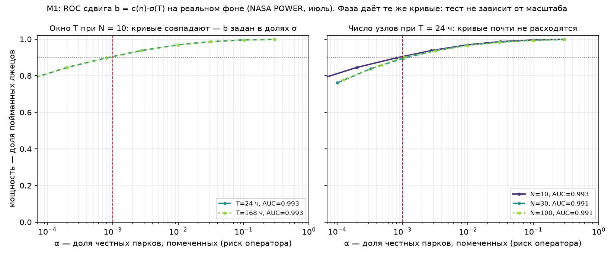

# Entrain · M1 + M2 — GLRT, объявленный риск, минимально обнаружимое b, теорема о сговоре

Ход 1 (§1–§11): детектор, σ на реальном фоне, b_min(N, T, σ), инъекции, ROC. Ход 2 (§12): почему сговор разбавляется именно так и где заканчиваются замеры. Отчёт собран из `bench/results.json`; ни одно число ниже не набрано от руки. α = 0.001, мощность 0.9, окна 1 ч, 24 ч, 168 ч, парки 10, 30, 100 узлов, фон — реальная солнечная радиация (NASA POWER 2021, PVGIS 2020).

```
python bench/fetch.py          # скачать фон, записать манифест с sha256
python -m entrain_infer        # прогнать bench, собрать REPORT.md и roc.png
python -m pytest               # проверки математики и оценщика
```

| файл                         | что это                                                       |
|------------------------------|---------------------------------------------------------------|
| `entrain_infer/detector.py`  | GLRT: статистика, нулевая таблица, мощность, b_min            |
| `entrain_infer/theorem.py`   | Ход 2: теорема о сговоре — замкнутые формулы, без Монте-Карло |
| `entrain_infer/estimator.py` | две наблюдаемые: фаза и частота против часов парка            |
| `entrain_infer/model.py`     | единицы и объявленные константы                               |
| `entrain_infer/bench.py`     | реальный фон, сборка парка, инъекции, замеры                  |
| `entrain_infer/report.py`    | этот отчёт и ROC-картинка                                     |
| `bench/criteria.json`        | предрегистрация: α, критерии, seed — до прогона               |
| `bench/criteria_m2.json`     | предрегистрация Хода 2: девять предсказаний — до прогона      |
| `bench/manifest.json`        | sha256 каждого байта фона                                     |
| `bench/results.json`         | всё измеренное, машинночитаемо                                |
| `README.md`                  | как это запустить и что объявлено до прогона                  |
| `tests/`                     | математика, оценщик, инъекции                                 |

---

## 0. Резюме

1. **Порога 0.5 больше нет.** Оператор объявляет риск α = 0.001, порог следует из него: τ(n) — квантиль `max_k |t_k|` при H₀ по Монте-Карло (200000 розыгрышей, seed 20261030). τ(10) = 3.875, τ(100) = 4.424; граница Бонферрони даёт 3.891 и 4.417 — согласие в третьем знаке.

2. **σ измерен, а не заявлен.** На реальном фоне (nasa_power_2021, july) разброс частоты вокруг парка: **2.4 мин/сутки при T = 24 ч** и **2.0 мин/сутки при T = 168 ч**. Второй источник (PVGIS 2020) при T = 24 ч даёт 4.5 мин/сутки: короткое окно читает погоду своей базы, и базы расходятся. При T = 168 ч обе дают ≈2.0 мин, потому что там σ уже стоит на объявленном дрожании σ_honest = 2 мин/сутки: совпадение источников на длинном окне — заслуга допущения, а не измерения (§11).

3. **Минимально обнаружимое смещение b** при α = 0.001 и мощности 0.9: для N = 10 — **11 мин/сутки** за T = 168 ч и **13 мин/сутки** за T = 24 ч. За T = 1 ч частота не читается вовсе: окно короче оборота (§6).

4. **Предел ставит честность, а не число узлов.** Коэффициент c(n) = b_min/σ растёт с N всего с 5.42 до 5.74: сотня узлов не покупает ничего сверх десяти. Покупает длину окна — но только пока σ не упёрся в пол: в январе b_min падает в 12.2 раза при 24 ч → 168 ч (25.2 → 2.1 мин), в июле — в 1.2 раза (2.4 → 2.0 мин), потому что там σ уже на объявленном дрожании.

5. **У каждой лжи своя наблюдаемая.** Постоянный сдвиг метки виден в фазе целиком и невидим в частоте вовсе; скачок метки фаза видит наполовину, а частота — только как испорченную подгонку, без всякой формулы; умножение уровня не видно нигде — физика слепа к нему по построению (§8).

6. **Сговор разбавлен ровно по формуле.** k узлов с одинаковым скачком дают b_eff = b·(n−k)/(n−1) с точностью 0.010 (§9): доказательство — §12, здесь только замер.

7. **Объявленный α держится на нормальном H₀ — и это видно.** Два контрольных лжеца (уровень ×1.6 и постоянный сдвиг метки) не видит ни одна наблюдаемая, но в клетке nasa_power_2021, july, T = 24 ч частота поднимает тревогу в 14.0% окон при объявленном α = 0.001: там эксцесс фона 1.69, и квантиль нормального H₀ этот хвост не покрывает (§10, критерии 5–6; §11).

8. **Сговор стал теоремой (§12).** Парк видит только контраст, поэтому: сговор всех N невидим при любом b (в поле — 0.0% тревог при b = 20σ, если 10 узлов лгут вместе); при k > N/2 детектор срабатывает и называет честных — до 100.0% тревог на честном узле; b_min(k)/b_min(1) не выше (N−1)/max(k, N−k), с равенством на концах k = 1 и k = N−1; и ориентация раскола ненаблюдаема: «k лгут на +b» и «N−k лгут на −b» дают один и тот же вердикт, потому что различие лежит в ядре. Обратная сторона — якорь: он делает большинство видимым, но стоит точности против одиночки, и потому оправдан только против коалиций больше √N.

## 1. Что объявлено до прогона

`bench/criteria.json`, sha256 `23dd1c8580cb4e80e874d552502a6249…`, объявлен 2026-10-30. Файл написан до прогона и в прогоне не менялся: изменение — это новый прогон и новый отчёт.

| величина              | значение                         | смысл                                                                                                        |
|-----------------------|----------------------------------|--------------------------------------------------------------------------------------------------------------|
| α                     | 0.001                            | заявленный риск ложной тревоги оператора на одно окно: доля честных парков размера n, которые будут помечены |
| мощность              | 0.9                              | минимально обнаружимое b определяется как b, при котором мощность = 1 - beta = 0.9 при объявленном alpha     |
| σ_honest              | 3.636103e-04 рад/ч = 2 мин/сутки | честное дрожание частоты узла (объявлено, не измерено)                                                       |
| σ_read                | 2%                               | шум чтения прибора от амплитуды                                                                              |
| N                     | 10, 30, 100                      | размеры парка                                                                                                |
| T                     | 1 ч, 24 ч, 168 ч                 | длины окна                                                                                                   |
| полоса поиска         | ±275 мин/сутки                   | приор частоты: вне полосы это уже не «парк с одним лжецом»                                                   |
| повторов σ / инъекций | 200 / 100                        | свежий парк на каждый повтор                                                                                 |

**Критерии, названные до прогона.** Вердикт по каждому — §10.

| № | критерий                | что должно быть                                                                                                                                                                    |
|---|-------------------------|------------------------------------------------------------------------------------------------------------------------------------------------------------------------------------|
| 1 | 1_threshold             | для каждого n порог tau берётся из Монте-Карло (200000 розыгрышей, seed 20261030) и печатается рядом с границей Бонферрони; расхождение ожидается в сторону меньшего tau у МК      |
| 2 | 2_alpha_measured        | измеренная доля ложных тревог на свежих нулевых розыгрышах должна попасть в интервал alpha * [0.5, 2.0] — иначе объявленный alpha неверен                                          |
| 3 | 3_power_at_b_min        | проверочная МК-мощность в точке b_min должна быть в пределах 0.90 +/- 0.02; таблица b_min строится по коэффициенту c(n) и измеренной sigma                                         |
| 4 | 4_step_detected         | сдвиг метки времени на +2 ч в середине окна должен ловиться с частотой >= 0.9 при alpha = 1e-3 для T in {24, 168}                                                                  |
| 5 | 5_level_blind           | умножение уровня на 1.6 НЕ должно ловиться: частота обнаружения в пределах alpha +/- 0.02 (контроль слепоты)                                                                       |
| 6 | 6_constant_offset_blind | постоянный сдвиг метки на 2 ч на всём окне (чистый фазовый сдвиг) НЕ должен ловиться: частота в пределах alpha +/- 0.02 (контроль калибровочной симметрии)                         |
| 7 | 7_collusion             | измеренное b_eff для k сговорившихся должно следовать (n-k)/(n-1) от b_eff при k=1 с допуском 0.05                                                                                 |
| 8 | 8_bmin_floor            | b_min должен выходить на плато при росте T: отношение b_min(168)/b_min(24) должно быть заметно больше 1 при малом n и стремиться к 1 по мере роста n — плато задаётся SIGMA_HONEST |

## 2. Данные: реальный фон

Синтетика здесь ровно в одном месте — в инъекциях. Фон реален: почасовые ряды приходящей солнечной радиации в точке 56.13 N, 40.40 E, два независимых источника. Парк из n производителей собирается из одного окна: общая погода, свой масштаб, свой шум чтения, своё честное дрожание частоты.

| источник        | кто                                             | период                   | байт    | sha256                    |
|-----------------|-------------------------------------------------|--------------------------|---------|---------------------------|
| nasa_power_2021 | NASA POWER (NASA Langley) -- open, no key       | 2021-01-01 .. 2021-12-31 | 159 871 | d9a1525ac008e285b383a770… |
| pvgis_2020      | PVGIS (European Commission JRC) -- open, no key | 2020-01-01 .. 2020-12-31 | 744 591 | d264521f1f2831802fbebb72… |

Целостность: `python bench/fetch.py --check` падает, если сдвинулся хоть один байт фона. Манифест — `bench/manifest.json`.

> Почему не FNET/GridEye и не ENTSO-E, как значилось в плане: там нет открытого эталонного ряда по конкретной точке с часовым разрешением, который можно перекачать побайтово и захешировать. NASA POWER и PVGIS дают именно это. PMU-фон — следующий шаг (доступ, согласование) и математику не меняет: детектор видит только σ и T.

## 3. Модель и детектор

Наблюдаемая — отклонение частоты узла от часов парка, посчитанное на окне (§4 объясняет, как оно получается): `x_i`, i = 1..n. Честные узлы стоят вокруг общего среднего парка:

```
H0:  x_i ~ N(mu, sigma^2),                       i = 1..n
H1:  x_k ~ N(mu + b, sigma^2) для одного неизвестного k,  b != 0
```

`mu` и `b` — мешающие параметры, оба профилируются. Для кандидата `k` профильные МП-оценки: `mu_hat = mean_{i!=k} x_i`, `b_hat = x_k - mu_hat`, и отношение правдоподобия сводится к t-статистике:

```
Lam_k = b_hat^2 / (2 sigma^2 (1 + 1/(n-1))) = (1/2) t_k^2
t_k   = (n x_k - sum_i x_i) / sqrt(n (n-1))     — в замкнутой форме
G     = max_k |t_k|                             — статистика GLRT
```

**Почему не z-тест на каждый узел.** Остатки `t_k` коррелированы (corr = −1/(n−1)) и максимум по n из них — не одна нормальная величина. Поэтому порог берётся из распределения самого `G`, которое зависит только от n: ни от σ, ни от μ. Это и есть строка «τ(n)» ниже.

**Порог — не магия, а объявленный риск.** τ(n) = квантиль уровня 1−α распределения G при H0, α = 0.001 — доля честных парков, которую оператор согласен помечать. Монте-Карло против границы Бонферрони:

| N   | τ (Монте-Карло) | τ (Бонферрони) | разница | ошибка τ | c(n) = b_min/σ |
|-----|-----------------|----------------|---------|----------|----------------|
| 10  | 3.875           | 3.891          | 0.0153  | 0.017    | 5.420          |
| 30  | 4.154           | 4.149          | -0.0050 | 0.019    | 5.513          |
| 100 | 4.424           | 4.417          | -0.0066 | 0.012    | 5.740          |

Монте-Карло выше Бонферрони для N = 30 (на 0.0050), N = 100 (на 0.0066), но на величину порядка собственной ошибки квантили; наибольший зазор по модулю 0.015 при ошибке квантили 0.019. Так и должно быть: Бонферрони игнорирует корреляцию остатков (corr = −1/(n−1)) и потому переплачивает строгостью; с ростом n корреляция исчезает, границы сходятся, и разница уходит в шум. Порог всё равно берётся из Монте-Карло, Бонферрони печатается как независимая проверка.

Измеренная доля ложных тревог на свежих нулевых розыгрышах при α = 0.001: частота — 0.00080…0.00105, фаза — 0.00080…0.00105 против объявленных 0.00100 — объявленный риск выполняется на нормальном H₀ (§10 критерий 2; что бывает, когда H₀ не нормален, — §8 и §11).

`c(n) = b_min/σ` — вся зависимость от n. Она почти плоская: доска из 100 узлов не даёт радикально больше, чем доска из 10. Мощность при b = b_min равна 0.9 по построению (§6, таблица проверки).

## 4. Как парк читается: две наблюдаемые

Модуль `entrain_infer.estimator`. Часы парка — сутки: один оборот за 24 ч, ω₀ = 2π/24 = 0.261799 рад/ч. Из ряда узла извлекаются ровно две величины, и выбор между ними решает, какую ложь видно.

| наблюдаемая | как считается                                                             | единица | что видит                                                         |
|-------------|---------------------------------------------------------------------------|---------|-------------------------------------------------------------------|
| фаза        | arg Σ_t (y_t − ȳ) e^(−iω₀t)                                               | рад     | постоянный сдвиг метки: τ ч → 2πτ/24                              |
| частота     | argmin по ω гармонической регрессии (3 гармоники) в полосе ±275 мин/сутки | рад/ч   | постоянный дрейф; скачок метки — лишь частично, и не как скорость |

Три объявленных предела, а не открытых в прогоне:

* **Частота требует оборота.** `MIN_READ_HOURS = 24`: внутри суток суточный цикл не замкнулся, частота не идентифицируема, и оценщик отказывается, вместо того чтобы уверенно соврать.
* **Фаза требует переопределённой подгонки.** DC плюс одна гармоника — это уже три параметра, поэтому `MIN_PHASE_SAMPLES = 4`: на двух отсчётах фазы нет вовсе, есть один бит — вырос ряд за окно или упал (фазор при двух точках это положительный скаляр на фиксированное комплексное число, и от данных остаётся только знак). Оценщик отказывается так же, как для частоты, и клетки T = 1 ч в таблицах фазы нет.
* **Полоса поиска — это приор.** Вне неё парк — уже не «честные узлы плюс один лжец», а другой механизм.

Солнечный ряд ночью равен нулю, и нули несут нулевой вес в обеих формулах — маскировать ночь не нужно и не делается. Отсюда следствие, которое видно в §6: часовое окно не даёт ни частоты (оборот не замкнулся), ни фазы (два отсчёта — это знак изменения), и в таблицах там стоит «недостижимо», а не шум.

> Гармоническая регрессия, а не пик периодограммы: выпрямленный суточный профиль не узкополосен, его вторая гармоника не слабее первой, и пик простой периодограммы тащит за собой форма дня, а не его частота. Три гармоники — мешающие параметры; сигнал — сама частота.

## 5. Шум: σ измерен на реальном фоне

Для каждой пары (источник, сезон, T) строится 200 свежих честных парков, каждая наблюдаемая центрируется внутри парка (детектор профилирует общее среднее — важно рассеяние вокруг парка, а не мнение парка о своих часах) и пул даёт σ. В σ входят три вещи сразу: честное дрожание частоты (σ_honest = 2 мин/сутки), шум чтения (2%) и неидеальность самой погоды.

**Частота** (единица — минуты смещения частоты за сутки):

| источник        | сезон   | T     | σ, рад/ч   | в минутах метки | эксцесс | точек |
|-----------------|---------|-------|------------|-----------------|---------|-------|
| nasa_power_2021 | january | 24 ч  | 0.0046     | 25.21           | -0.19   | 20000 |
| nasa_power_2021 | january | 168 ч | 3.7601e-04 | 2.07            | 0.17    | 20000 |
| nasa_power_2021 | april   | 24 ч  | 0.0010     | 5.71            | 1.10    | 20000 |
| nasa_power_2021 | april   | 168 ч | 3.7812e-04 | 2.08            | 0.08    | 20000 |
| nasa_power_2021 | july    | 24 ч  | 4.3377e-04 | 2.39            | 1.69    | 20000 |
| nasa_power_2021 | july    | 168 ч | 3.7051e-04 | 2.04            | 0.08    | 20000 |
| nasa_power_2021 | october | 24 ч  | 0.0019     | 10.65           | 0.82    | 20000 |
| nasa_power_2021 | october | 168 ч | 3.9101e-04 | 2.15            | 0.13    | 20000 |
| pvgis_2020      | january | 24 ч  | 0.0067     | 36.68           | -0.31   | 20000 |
| pvgis_2020      | january | 168 ч | 3.8406e-04 | 2.11            | 0.16    | 20000 |
| pvgis_2020      | april   | 24 ч  | 0.0012     | 6.84            | 0.67    | 20000 |
| pvgis_2020      | april   | 168 ч | 3.7211e-04 | 2.05            | 0.09    | 20000 |
| pvgis_2020      | july    | 24 ч  | 8.1225e-04 | 4.47            | 1.02    | 20000 |
| pvgis_2020      | july    | 168 ч | 3.7059e-04 | 2.04            | 0.08    | 20000 |
| pvgis_2020      | october | 24 ч  | 0.0021     | 11.65           | 0.36    | 20000 |
| pvgis_2020      | october | 168 ч | 3.7527e-04 | 2.06            | 0.12    | 20000 |

**Фаза** (в минутах сдвига метки):

| источник        | сезон   | T     | σ, рад | в минутах метки | эксцесс | точек |
|-----------------|---------|-------|--------|-----------------|---------|-------|
| nasa_power_2021 | january | 24 ч  | 0.0184 | 4.22            | —       | 20000 |
| nasa_power_2021 | january | 168 ч | 0.0322 | 7.38            | —       | 20000 |
| nasa_power_2021 | april   | 24 ч  | 0.0122 | 2.79            | —       | 20000 |
| nasa_power_2021 | april   | 168 ч | 0.0268 | 6.15            | —       | 20000 |
| nasa_power_2021 | july    | 24 ч  | 0.0126 | 2.90            | —       | 20000 |
| nasa_power_2021 | july    | 168 ч | 0.0299 | 6.85            | —       | 20000 |
| nasa_power_2021 | october | 24 ч  | 0.0151 | 3.46            | —       | 20000 |
| nasa_power_2021 | october | 168 ч | 0.0314 | 7.19            | —       | 20000 |
| pvgis_2020      | january | 24 ч  | 0.0199 | 4.56            | —       | 20000 |
| pvgis_2020      | january | 168 ч | 0.0311 | 7.12            | —       | 20000 |
| pvgis_2020      | april   | 24 ч  | 0.0128 | 2.93            | —       | 20000 |
| pvgis_2020      | april   | 168 ч | 0.0308 | 7.06            | —       | 20000 |
| pvgis_2020      | july    | 24 ч  | 0.0130 | 2.98            | —       | 20000 |
| pvgis_2020      | july    | 168 ч | 0.0296 | 6.77            | —       | 20000 |
| pvgis_2020      | october | 24 ч  | 0.0146 | 3.35            | —       | 20000 |
| pvgis_2020      | october | 168 ч | 0.0286 | 6.54            | —       | 20000 |

Читается главное:

* при T = 168 ч σ выходит на пол ≈ σ_honest — дальше окно не помогает, мешает уже честность, а не прибор;
* при T = 24 ч σ в разы больше и сильно зависит от сезона: короткий зимний день читается хуже длинного летнего;
* часового окна у фазы нет вовсе (§4): два отсчёта дают знак изменения, а не угол, и пул из таких чтений (два значения, разнесённые на пол-оборота) измеряет долю тёмных окон, а не разрешение. Клетка объявлена недостижимой и в таблицах стоит «недостижимо», а не число;
* эксцесс близок к нулю там, где окно длинное, — допущение о нормальности H₀ не опровергнуто, но и не доказано: это проверка, а не аксиома. У фазы эксцесса нет («—»): круговые данные не имеют честного четвёртого момента, пока не выбрана точка разреза, а она выбрана быть не может — это и есть та симметрия, из которой §8 делает вывод, что постоянный сдвиг метки невидим частоте по построению;

## 6. Минимально обнаружимое b(N, T, σ)

b_min — смещение, при котором мощность равна 0.9 при объявленном α = 0.001. Тест инвариантен к масштабу, поэтому b_min = c(n)·σ, а σ измерен в §5: таблицы ниже — произведение, а не надежда.

### 6.1 Частота: сколько минут в сутки можно утащить незамеченным

| источник        | сезон   | T     | N=10        | N=30        | N=100       |
|-----------------|---------|-------|-------------|-------------|-------------|
| nasa_power_2021 | january | 1 ч   | недостижимо | недостижимо | недостижимо |
| nasa_power_2021 | january | 24 ч  | 136.6       | 139.0       | 144.7       |
| nasa_power_2021 | january | 168 ч | 11.2        | 11.4        | 11.9        |
| nasa_power_2021 | april   | 1 ч   | недостижимо | недостижимо | недостижимо |
| nasa_power_2021 | april   | 24 ч  | 31.0        | 31.5        | 32.8        |
| nasa_power_2021 | april   | 168 ч | 11.3        | 11.5        | 11.9        |
| nasa_power_2021 | july    | 1 ч   | недостижимо | недостижимо | недостижимо |
| nasa_power_2021 | july    | 24 ч  | 12.9        | 13.2        | 13.7        |
| nasa_power_2021 | july    | 168 ч | 11.0        | 11.2        | 11.7        |
| nasa_power_2021 | october | 1 ч   | недостижимо | недостижимо | недостижимо |
| nasa_power_2021 | october | 24 ч  | 57.7        | 58.7        | 61.2        |
| nasa_power_2021 | october | 168 ч | 11.7        | 11.9        | 12.3        |
| pvgis_2020      | january | 1 ч   | недостижимо | недостижимо | недостижимо |
| pvgis_2020      | january | 24 ч  | 198.8       | 202.2       | 210.5       |
| pvgis_2020      | january | 168 ч | 11.4        | 11.6        | 12.1        |
| pvgis_2020      | april   | 1 ч   | недостижимо | недостижимо | недостижимо |
| pvgis_2020      | april   | 24 ч  | 37.1        | 37.7        | 39.3        |
| pvgis_2020      | april   | 168 ч | 11.1        | 11.3        | 11.7        |
| pvgis_2020      | july    | 1 ч   | недостижимо | недостижимо | недостижимо |
| pvgis_2020      | july    | 24 ч  | 24.2        | 24.6        | 25.6        |
| pvgis_2020      | july    | 168 ч | 11.0        | 11.2        | 11.7        |
| pvgis_2020      | october | 1 ч   | недостижимо | недостижимо | недостижимо |
| pvgis_2020      | october | 24 ч  | 63.1        | 64.2        | 66.8        |
| pvgis_2020      | october | 168 ч | 11.2        | 11.4        | 11.8        |

Читается так: при T = 168 ч порог почти не зависит ни от сезона, ни от источника — 11.0–12.3 мин/сутки во всех восьми клетках. Это и есть цена недели: лжец может уводить часы на столько и оставаться незамеченным в 10% окон. За сутки диапазон шире — 12.9–210.5 мин: в июле короткое окно почти догоняет неделю (σ там уже на полу, §5), в январе не догоняет и близко. За час частота не читается вовсе: окно короче оборота.

### 6.2 Фаза: на сколько минут можно сдвинуть метку

| источник        | сезон   | T     | N=10        | N=30        | N=100       |
|-----------------|---------|-------|-------------|-------------|-------------|
| nasa_power_2021 | january | 1 ч   | недостижимо | недостижимо | недостижимо |
| nasa_power_2021 | january | 24 ч  | 22.9        | 23.3        | 24.2        |
| nasa_power_2021 | january | 168 ч | 40.0        | 40.7        | 42.3        |
| nasa_power_2021 | april   | 1 ч   | недостижимо | недостижимо | недостижимо |
| nasa_power_2021 | april   | 24 ч  | 15.1        | 15.4        | 16.0        |
| nasa_power_2021 | april   | 168 ч | 33.3        | 33.9        | 35.3        |
| nasa_power_2021 | july    | 1 ч   | недостижимо | недостижимо | недостижимо |
| nasa_power_2021 | july    | 24 ч  | 15.7        | 16.0        | 16.6        |
| nasa_power_2021 | july    | 168 ч | 37.1        | 37.8        | 39.3        |
| nasa_power_2021 | october | 1 ч   | недостижимо | недостижимо | недостижимо |
| nasa_power_2021 | october | 24 ч  | 18.7        | 19.1        | 19.8        |
| nasa_power_2021 | october | 168 ч | 39.0        | 39.6        | 41.3        |
| pvgis_2020      | january | 1 ч   | недостижимо | недостижимо | недостижимо |
| pvgis_2020      | january | 24 ч  | 24.7        | 25.1        | 26.1        |
| pvgis_2020      | january | 168 ч | 38.6        | 39.2        | 40.9        |
| pvgis_2020      | april   | 1 ч   | недостижимо | недостижимо | недостижимо |
| pvgis_2020      | april   | 24 ч  | 15.9        | 16.2        | 16.8        |
| pvgis_2020      | april   | 168 ч | 38.2        | 38.9        | 40.5        |
| pvgis_2020      | july    | 1 ч   | недостижимо | недостижимо | недостижимо |
| pvgis_2020      | july    | 24 ч  | 16.2        | 16.4        | 17.1        |
| pvgis_2020      | july    | 168 ч | 36.7        | 37.3        | 38.9        |
| pvgis_2020      | october | 1 ч   | недостижимо | недостижимо | недостижимо |
| pvgis_2020      | october | 24 ч  | 18.1        | 18.4        | 19.2        |
| pvgis_2020      | october | 168 ч | 35.5        | 36.1        | 37.6        |

Фаза здесь начинается с T = 24 ч, и это не пропуск данных: часовое окно при почасовых отсчётах — два отсчёта, они дают знак изменения, а не фазу (§4). Часовую фазу дал бы только подасовой поток, и тогда строка T = 1 ч появилась бы сама.

Обратите внимание на направление: у фазы **короткое окно точнее длинного** — при T = 24 ч b_min лежит в 15–26 мин во всех сезонах и обоих источниках, при T = 168 ч — 33–42 мин. Неделя не успокаивает фазу, а накапливает смену погоды внутри окна: одна гармоника вынуждена делить вес между днями, и чтение уплывает. Частота ведёт себя наоборот (§6.1), и это не парадокс: частота — производная, ей длинное окно даёт точку отсчёта, а фаза — уровень, ей длинное окно даёт больше разных погод.

Клетки «недостижимо» — это объявленные пределы данных, а не неудачные числа:

* фаза не идентифицируема на 2 отсчётах (нужно ≥ 4): окно даёт знак изменения, а не фазу;
* частота не идентифицируема внутри одного оборота: 1 ч < 24 ч;

### 6.3 Проверка: мощность в точке b_min, Монте-Карло против аналитики

| источник        | сезон   | T     | наблюдаемая | c(n)  | b_min (МК) | b_min (аналит.) | мощность |
|-----------------|---------|-------|-------------|-------|------------|-----------------|----------|
| nasa_power_2021 | january | 24 ч  | частота     | 5.420 | 0.02484    | 0.02491         | 0.901    |
| nasa_power_2021 | january | 168 ч | частота     | 5.420 | 0.00204    | 0.00204         | 0.901    |
| nasa_power_2021 | january | 24 ч  | фаза        | 5.420 | 0.09977    | 0.10006         | 0.901    |
| nasa_power_2021 | january | 168 ч | фаза        | 5.420 | 0.17443    | 0.17494         | 0.901    |
| nasa_power_2021 | april   | 24 ч  | частота     | 5.420 | 0.00563    | 0.00565         | 0.901    |
| nasa_power_2021 | april   | 168 ч | частота     | 5.420 | 0.00205    | 0.00206         | 0.901    |
| nasa_power_2021 | april   | 24 ч  | фаза        | 5.420 | 0.06594    | 0.06613         | 0.901    |
| nasa_power_2021 | april   | 168 ч | фаза        | 5.420 | 0.14539    | 0.14581         | 0.901    |
| nasa_power_2021 | july    | 24 ч  | частота     | 5.420 | 0.00235    | 0.00236         | 0.901    |
| nasa_power_2021 | july    | 168 ч | частота     | 5.420 | 0.00201    | 0.00201         | 0.901    |
| nasa_power_2021 | july    | 24 ч  | фаза        | 5.420 | 0.06847    | 0.06867         | 0.901    |
| nasa_power_2021 | july    | 168 ч | фаза        | 5.420 | 0.16202    | 0.16249         | 0.901    |
| nasa_power_2021 | october | 24 ч  | частота     | 5.420 | 0.01050    | 0.01053         | 0.901    |
| nasa_power_2021 | october | 168 ч | частота     | 5.420 | 0.00212    | 0.00213         | 0.901    |
| nasa_power_2021 | october | 24 ч  | фаза        | 5.420 | 0.08174    | 0.08198         | 0.901    |
| nasa_power_2021 | october | 168 ч | фаза        | 5.420 | 0.16996    | 0.17046         | 0.901    |
| pvgis_2020      | january | 24 ч  | частота     | 5.420 | 0.03614    | 0.03625         | 0.901    |
| pvgis_2020      | january | 168 ч | частота     | 5.420 | 0.00208    | 0.00209         | 0.901    |
| pvgis_2020      | january | 24 ч  | фаза        | 5.420 | 0.10774    | 0.10805         | 0.901    |
| pvgis_2020      | january | 168 ч | фаза        | 5.420 | 0.16831    | 0.16880         | 0.901    |
| pvgis_2020      | april   | 24 ч  | частота     | 5.420 | 0.00674    | 0.00676         | 0.901    |
| pvgis_2020      | april   | 168 ч | частота     | 5.420 | 0.00202    | 0.00202         | 0.901    |
| pvgis_2020      | april   | 24 ч  | фаза        | 5.420 | 0.06937    | 0.06957         | 0.901    |
| pvgis_2020      | april   | 168 ч | фаза        | 5.420 | 0.16685    | 0.16734         | 0.901    |
| pvgis_2020      | july    | 24 ч  | частота     | 5.420 | 0.00440    | 0.00442         | 0.901    |
| pvgis_2020      | july    | 168 ч | частота     | 5.420 | 0.00201    | 0.00201         | 0.901    |
| pvgis_2020      | july    | 24 ч  | фаза        | 5.420 | 0.07054    | 0.07075         | 0.901    |
| pvgis_2020      | july    | 168 ч | фаза        | 5.420 | 0.16016    | 0.16063         | 0.901    |
| pvgis_2020      | october | 24 ч  | частота     | 5.420 | 0.01147    | 0.01151         | 0.901    |
| pvgis_2020      | october | 168 ч | частота     | 5.420 | 0.00203    | 0.00204         | 0.901    |
| pvgis_2020      | october | 24 ч  | фаза        | 5.420 | 0.07911    | 0.07934         | 0.901    |
| pvgis_2020      | october | 168 ч | фаза        | 5.420 | 0.15476    | 0.15522         | 0.901    |

Аналитическая форма `b_min = (τ + z_(1−β))·σ·√(1+1/(n−1))` игнорирует шанс, что порог перейдёт честный узел, поэтому она оптимистичнее точной — в таблице видно, насколько. Мощность в самой точке b_min держится около объявленной: это и есть смысл слова «b_min».

## 7. ROC



Кривая строится честно: для каждого α порог берётся из нулевой таблицы, доля ложных тревог **измеряется** на свежих нулевых розыгрышах (поэтому она колеблется вокруг α, а не равна ему тождественно), мощность измеряется против одного лгущего узла со сдвигом b = c(n)·σ — то есть ровно в точке b_min (§6), и потому кривая проходит через рабочую точку (α, мощность) = (0.001, 0.9). Красный пунктир — объявленный α = 0.001, серая линия — целевая мощность; все кривые проходят через их пересечение, потому что b задан как b_min.

**Площадь под кривой по числу узлов** (N почти не двигает AUC):

| наблюдаемая | N     | T    | AUC    |
|-------------|-------|------|--------|
| частота     | N=10  | 24 ч | 0.9926 |
| частота     | N=30  | 24 ч | 0.9912 |
| частота     | N=100 | 24 ч | 0.9906 |
| фаза        | N=10  | 24 ч | 0.9926 |
| фаза        | N=30  | 24 ч | 0.9912 |
| фаза        | N=100 | 24 ч | 0.9906 |

**Площадь под кривой по длине окна** (и вот здесь важно, что именно двигает):

| наблюдаемая | T     | AUC    |
|-------------|-------|--------|
| частота     | 24 ч  | 0.9926 |
| частота     | 168 ч | 0.9926 |
| фаза        | 24 ч  | 0.9926 |
| фаза        | 168 ч | 0.9926 |

Разброс AUC по T равен 0.0000 — то есть нулю, и это не совпадение, а свойство теста: b задан в долях σ (b = c(n)·σ), а статистика инвариантна к масштабу, поэтому кривая зависит только от b/σ = c(n). Таблица по T — проверка этой инвариантности, а не измерение длины окна. Длина окна входит в задачу через σ, а σ измерен в §5: именно он сдвигает рабочую точку вдоль кривой и задаёт b_min в §6. ROC отвечает на вопрос «какую мощность даёт такой-то b/σ», §5–§6 — на вопрос «какой b достижим за такое-то окно».

**Мощность при N = 10 по сетке α:**

| наблюдаемая | T     | α≈0.0001 | α≈0.001 | α≈0.01 | α≈0.1 |
|-------------|-------|----------|---------|--------|-------|
| частота     | 24 ч  | 0.78     | 0.90    | 0.97   | 1.00  |
| частота     | 168 ч | 0.78     | 0.90    | 0.97   | 1.00  |
| фаза        | 24 ч  | 0.78     | 0.90    | 0.97   | 1.00  |
| фаза        | 168 ч | 0.78     | 0.90    | 0.97   | 1.00  |

Число узлов двигает кривую ровно настолько, насколько c(n) отличается от c(n′): c(10) = 5.42 против c(100) = 5.74. Отсюда вывод, который и был целью Хода 1: точность покупается не числом узлов, а тем, насколько σ удалось сбить длиной окна, и упирается она в σ_honest, а не в прибор.

## 8. Инъекции: у каждой лжи своя наблюдаемая

Контролируемые инъекции на реальном фоне (nasa_power_2021, january, N = 10), 100 повторов на клетку, порог при α = 0.001. В скобках — сдвиг, который видит **статистика** (чтение лжеца минус среднее остальных узлов), в минутах метки; для частоты — минуты в сутки. Это меньше физического сдвига по двум причинам сразу: профилированное среднее содержит самого лжеца и потому срезает (n−1)/n даже у одиночки — постоянный сдвиг 120 мин виден как 108 мин, — а при группе добавляется (n−k)/(n−1) (§9).

| инъекция                               | частота 24 ч   | частота 168 ч   | фаза 24 ч        | фаза 168 ч       |
|----------------------------------------|----------------|-----------------|------------------|------------------|
| скачок метки +2 ч в середине           | 0.0% (43 мин)  | 100.0% (24 мин) | 100.0% (58 мин)  | 99.0% (53 мин)   |
| постоянный сдвиг метки +2 ч (контроль) | 0.0% (-11 мин) | 0.0% (-0 мин)   | 100.0% (108 мин) | 100.0% (108 мин) |
| уровень x1.6 (контроль)                | 0.0% (2 мин)   | 0.0% (-0 мин)   | 0.0% (-0 мин)    | 0.0% (-0 мин)    |
| сговор k узлов, k=1                    | 0.0% (43 мин)  | 100.0% (24 мин) | 100.0% (58 мин)  | 99.0% (53 мин)   |
| сговор k узлов, k=2                    | 0.0% (39 мин)  | 100.0% (22 мин) | 100.0% (51 мин)  | 100.0% (47 мин)  |
| сговор k узлов, k=3                    | 0.0% (34 мин)  | 100.0% (19 мин) | 100.0% (45 мин)  | 100.0% (41 мин)  |
| сговор k узлов, k=5                    | 0.0% (25 мин)  | 100.0% (14 мин) | 100.0% (32 мин)  | 100.0% (29 мин)  |

Карта не тождественна, и это не баг, а основной результат Хода 1:

* **скачок метки** (+2 ч в середине окна) читается обеими наблюдаемыми, но по-разному. Фаза видит половину скачка — вторую половину окна, — потому что уехала только она. Частота не видит *скорости* вовсе: скачок не делает часы быстрее, он портит гармоническую подгонку, и оценщик возвращает некий паллиатив (замер — в таблице). Обе величины здесь измерены, а не выведены: «сколько минут скачка видит частота» не имеет формулы, потому что это артефакт подгонки;
* **постоянный сдвиг** метки — чистый фазовый сдвиг: **фаза его видит целиком, частота не видит вовсе**. Это не слабость детектора, это gauge-структура: постоянный сдвиг всех меток неотличим от сдвига часов парка, и потому детектор честно молчит. Ход 2 делает это утверждение теоремой;
* **уровень x1.6** не виден нигде: физика парка слепа к масштабу по построению, и никакой статистикой это не лечится — лечится другой наблюдаемой;
* **контрольные инъекции — это ещё и проверка α.** Сдвига не видит ни одна клетка (0.0–0.3 мин), но тревог всё равно больше объявленного: 10.0% для уровня и 14.0% для постоянного сдвига в клетке july, T = 24 ч, где эксцесс фона 1.69 (§5). Объявленный α — это α *при нормальном H₀*; где фон не нормален, детектор об этом честно ошибается, а не молчит;
* **сговор** разбавлен, см. §9. Разбавление — тоже не дефект: это цена того, что парк сравнивает узлы между собой.

## 9. Сговор: замер разбавления

k узлов делают одинаковый скачок метки (+2 ч) в january, T = 168 ч, α = 0.001. Теория (детектор, §3, и Ход 2): лжец сравнивается с честными, и общий сдвиг группы уменьшает его видимый сдвиг ровно в (n−k)/(n−1) раз.

| N   | наблюдаемая | k | (n−k)/(n−1) теория | замер | разница    | b_eff, мин | обнаружено |
|-----|-------------|---|--------------------|-------|------------|------------|------------|
| 10  | частота     | 1 | 1.000              | 1.000 | 0.000      | 24.5       | 100.0%     |
| 10  | частота     | 2 | 0.889              | 0.897 | 0.008      | 22.0       | 100.0%     |
| 10  | частота     | 3 | 0.778              | 0.785 | 0.008      | 19.2       | 100.0%     |
| 10  | частота     | 5 | 0.556              | 0.559 | 0.003      | 13.7       | 100.0%     |
| 10  | фаза        | 1 | 1.000              | 1.000 | 0.000      | 52.6       | 99.0%      |
| 10  | фаза        | 2 | 0.889              | 0.897 | 0.008      | 47.1       | 100.0%     |
| 10  | фаза        | 3 | 0.778              | 0.787 | 0.009      | 41.3       | 100.0%     |
| 10  | фаза        | 5 | 0.556              | 0.558 | 0.002      | 29.3       | 100.0%     |
| 30  | частота     | 1 | 1.000              | 1.000 | 0.000      | 26.4       | 100.0%     |
| 30  | частота     | 2 | 0.966              | 0.966 | 8.306e-04  | 25.6       | 100.0%     |
| 30  | частота     | 3 | 0.931              | 0.928 | -0.003     | 24.5       | 100.0%     |
| 30  | частота     | 5 | 0.862              | 0.862 | -3.959e-04 | 22.8       | 100.0%     |
| 30  | фаза        | 1 | 1.000              | 1.000 | 0.000      | 57.1       | 100.0%     |
| 30  | фаза        | 2 | 0.966              | 0.969 | 0.004      | 55.3       | 100.0%     |
| 30  | фаза        | 3 | 0.931              | 0.927 | -0.004     | 52.9       | 100.0%     |
| 30  | фаза        | 5 | 0.862              | 0.862 | 2.318e-04  | 49.2       | 100.0%     |
| 100 | частота     | 1 | 1.000              | 1.000 | 0.000      | 26.9       | 100.0%     |
| 100 | частота     | 2 | 0.990              | 0.989 | -4.579e-04 | 26.7       | 100.0%     |
| 100 | частота     | 3 | 0.980              | 0.986 | 0.006      | 26.6       | 100.0%     |
| 100 | частота     | 5 | 0.960              | 0.965 | 0.005      | 26.0       | 100.0%     |
| 100 | фаза        | 1 | 1.000              | 1.000 | 0.000      | 58.0       | 100.0%     |
| 100 | фаза        | 2 | 0.990              | 0.990 | -3.776e-04 | 57.4       | 100.0%     |
| 100 | фаза        | 3 | 0.980              | 0.989 | 0.009      | 57.4       | 100.0%     |
| 100 | фаза        | 5 | 0.960              | 0.968 | 0.009      | 56.2       | 100.0%     |

Смысл для оператора: разбавление тем сильнее, чем меньше парк и больше группа — при N = 10 сговор из 5 узлов оставляет 55.6% видимого сдвига, при N = 100 те же 5 — 96.0%, а сговор всех n узлов невидим по построению — их среднее и есть мнение парка. Отсюда прямо следует, что «голосование большинством» не является детектором обмана: оно является его усилителем. §12 превращает это в теорему: за N/2 замеры кончаются, и дальше начинается утверждение, а не число.

## 10. Вердикты по критериям, названным до прогона

| № | критерий                                                                                                                                                                           | вердикт      | что измерено                                                                                                                                                                                                                                                                                                                                                                                                                                                                                                                                                                           |
|---|------------------------------------------------------------------------------------------------------------------------------------------------------------------------------------|--------------|----------------------------------------------------------------------------------------------------------------------------------------------------------------------------------------------------------------------------------------------------------------------------------------------------------------------------------------------------------------------------------------------------------------------------------------------------------------------------------------------------------------------------------------------------------------------------------------|
| 1 | для каждого n порог tau берётся из Монте-Карло (200000 розыгрышей, seed 20261030) и печатается рядом с границей Бонферрони; расхождение ожидается в сторону меньшего tau у МК      | не выполнено | максимальный зазор |τ(МК) − τ(Бонферрони)| = 0.015 при ошибке самой квантили 0.019; МК выше Бонферрони для N = 30 на 0.005, N = 100 на 0.007, то есть в пределах шума квантиля, но объявленное направление для этих N не выполнено. Порог и так берётся из МК, Бонферрони печатается как проверка, а не как источник                                                                                                                                                                                                                                                                   |
| 2 | измеренная доля ложных тревог на свежих нулевых розыгрышах должна попасть в интервал alpha * [0.5, 2.0] — иначе объявленный alpha неверен                                          | выполнено    | измеренная доля ложных тревог при α = 0.001: от 0.00080 до 0.00105 (объявленный коридор α·[0.5, 2] = [0.00050, 0.00200]; 40000 нулевых розыгрышей на кривую)                                                                                                                                                                                                                                                                                                                                                                                                                           |
| 3 | проверочная МК-мощность в точке b_min должна быть в пределах 0.90 +/- 0.02; таблица b_min строится по коэффициенту c(n) и измеренной sigma                                         | выполнено    | максимальное отклонение мощности в точке b_min от цели: 0.0009                                                                                                                                                                                                                                                                                                                                                                                                                                                                                                                         |
| 4 | сдвиг метки времени на +2 ч в середине окна должен ловиться с частотой >= 0.9 при alpha = 1e-3 для T in {24, 168}                                                                  | выполнено    | лучшая наблюдаемая: T=24 ч → 100.0%, T=168 ч → 100.0% (критерий читается как «хотя бы одной наблюдаемой»)                                                                                                                                                                                                                                                                                                                                                                                                                                                                              |
| 5 | умножение уровня на 1.6 НЕ должно ловиться: частота обнаружения в пределах alpha +/- 0.02 (контроль слепоты)                                                                       | не выполнено | уровень ×1.6 не виден: в худшей клетке (nasa_power_2021, july, T = 24 ч, частота, N = 100) видимый сдвиг 0.3 мин, то есть ноль, — но доля тревог там 10.0% при α = 0.001. Это не ложь детектора, а фон: эксцесс в этой клетке 1.69 (§5), хвост тяжелее нормального, а порог выведен из нормального H₀ — α держится на нормальном H₀ и разваливается там, где его нет                                                                                                                                                                                                                   |
| 6 | постоянный сдвиг метки на 2 ч на всём окне (чистый фазовый сдвиг) НЕ должен ловиться: частота в пределах alpha +/- 0.02 (контроль калибровочной симметрии)                         | не выполнено | постоянный сдвиг метки не виден: в худшей клетке (nasa_power_2021, july, T = 24 ч, частота, N = 100) видимый сдвиг -0.1 мин, то есть ноль, — но доля тревог там 14.0% при α = 0.001. Это не ложь детектора, а фон: эксцесс в этой клетке 1.69 (§5), хвост тяжелее нормального, а порог выведен из нормального H₀ — α держится на нормальном H₀ и разваливается там, где его нет; фаза его видит: до 100.0% — как и должно быть, это gauge-сдвиг                                                                                                                                        |
| 7 | измеренное b_eff для k сговорившихся должно следовать (n-k)/(n-1) от b_eff при k=1 с допуском 0.05                                                                                 | выполнено    | максимальное расхождение замера с (n−k)/(n−1) на 54 клетках, где одиночка перекрывает b_min: 0.0102. Ещё 18 клеток (july, T = 24 ч, частота) исключены: там скачок метки вообще не виден частоте — её b_eff для одиночки ниже собственного b_min, — и отношение шума к шуму даёт до 0.245 ни о чём не говоря                                                                                                                                                                                                                                                                           |
| 8 | b_min должен выходить на плато при росте T: отношение b_min(168)/b_min(24) должно быть заметно больше 1 при малом n и стремиться к 1 по мере роста n — плато задаётся SIGMA_HONEST | не выполнено | (критерий записан как b_min(168)/b_min(24); ниже то же отношение в обратную сторону) b_min(24 ч)/b_min(168 ч) по N: N=10 → 1.17, N=30 → 1.17, N=100 → 1.17; разброс по N — 2.220e-16: отношение равно σ(24)/σ(168) при любом N, потому что c(n) не зависит от T, а σ не зависит от N. Плато по N сидит в c(n): N=10 → c=5.42, N=30 → c=5.51, N=100 → c=5.74. Итог: первая половина (T даёт выигрыш: отношение > 1 при любом N) выполнена — но величина выигрыша сезонная, а не узловая: 1.17 в july, 12.2 в январе; вторая половина (отношение стремится к 1 с ростом N) не выполнена. |

Критерий, который не выполнился, остаётся в отчёте невыполненным — иначе предрегистрация ничего не стоит. У Хода 2 свои критерии, объявленные отдельно (`bench/criteria_m2.json`) и проверенные в §12.6.

## 11. Что это доказывает и чего не доказывает

**Доказывает:**

* порог выводится из объявленного риска α = 0.001 и не зависит ни от σ, ни от μ — только от n (§3);
* на реальном фоне σ измерим, и b_min(N, T, σ) — число, а не лозунг (§5, §6);
* скачок метки +2 ч ловится на недельном окне практически всегда; постоянный сдвиг метки не ловится в частоте и ловится в фазе; умножение уровня не ловится нигде (§8);
* сговор разбавляется ровно по (n−k)/(n−1) (§9).

**Что доказано уже не замером, а теоремой (§12):**

* сговор всех N невидим при любом b — это ядро отображения «парк → контраст», а не слабость детектора;
* при k > N/2 тот же детектор срабатывает и называет честных: инверсия следует из знака E t вне группы, а не из ошибки реализации;
* ориентация раскола ненаблюдаема: «k лгут на +b» и «N−k лгут на −b» — одно и то же наблюдение, поэтому всякий протокол, решающий спор большинством, есть выбор калибровки, а не вывод из данных;
* b_min(k) ≤ b_min(1)·(N−1)/max(k, N−k), с равенством на концах; тест хорды не слабее теста узла при любом k и требует знать S заранее.

**Не доказывает:**

* что σ_honest = 2 мин/сутки — правда о живом парке. Это *объявленная* величина, и именно она задаёт пол на недельном окне: плато в §6 — следствие допущения, а не открытие. Замер σ_honest на живом парке — отдельная работа, и до неё числа на T = 168 ч читаются как «при таком-то допущении»;
* нормальность H₀. Эксцесс в §5 близок к нулю на длинных окнах, но это проверка на одном фоне и одной погоде, а не теорема. Тяжёлые хвосты сдвинут порог вверх и b_min вместе с ним — и цена уже видна: 14.0% тревог на контрольной инъекции в клетке с эксцессом 1.69 при объявленном α = 0.001 (§10, критерии 5–6). Детектор, гарантирующий α при любом H₀, — это отдельная задача (перестановочный тест); здесь α объявлен для нормального;
* что инъекции покрывают реальные способы лгать. Смоделированы три: скачок, постоянный сдвиг, уровень. Не смоделированы: дрейф, зависящий от погоды; избирательное молчание; подмена истории задним числом; сговор с разными сдвигами;
* перенос на другие физики. Часы парка здесь — сутки, наблюдаемая — солнце. Для ветра, PMU или тепла нужно заново измерить σ и заново объявить полосу поиска: математика та же, числа другие;
* что α покрывает весь парк целиком. α — риск **на один парк на одно окно**. Если оператор смотрит 200 парков каждый час, честная ставка тревог в час — это 200/168·α, и её надо объявлять отдельно;
* что «больше узлов не помогает» — общее правило. Здесь это верно для одного лжеца: c(n) почти плоская, потому что b_min растёт как √(1+1/(n−1)). Для группы из k лжецов выигрыш отрицательный — сговор усиливается числом (§9).

**Что бы это опровергло:** живой парк, у которого σ частоты заметно больше измеренной здесь (2.4 мин/сутки при T = 24 ч и 2.0 при 168 ч) — тогда b_min вырастет, и Ход 1 придётся повторять на его данных, а не на NASA POWER. Поэтому M1 заканчивается кодом и критериями, а не выводами о природе.

## 12. Ход 2: теорема о сговоре — что именно симметрично

§9 измерил разбавление. Здесь оно выводится — и выводится вместе с границей, за которой замеры M1 кончаются: за N/2. Все предсказания этого раздела записаны формулами (`entrain_infer/theorem.py`) и объявлены в `bench/criteria_m2.json` (sha256 `c8cfbad1c8e5a374…`) до прогона; прогон их только проверяет. α = 0.001, целевая мощность 0.9.

**Наблюдение, из которого всё следует.** Детектор видит только контраст

```
t_i = (N x_i − Σ_j x_j) / √(N(N−1)),      t(x + c·1) = t(x)  для любого c.
```

Это не погрешность и не удобство: это единственная симметрия парка — калибровка. Замер: сдвиг статистики при c = ±10³ равен 1.97e-13 — ноль в пределах машинной точности, на 15 парах миров.

### 12.1 Утверждение 1: сговор всех — ядро

Если лгут все N узлов одинаково, то `1_S = 1`, `P_H 1_S = 0`, и наблюдение не меняется вообще: **невидимо при любом b, любом N, любой мощности.** Это не следствие слабости GLRT — это следствие того, что у парка нет внешних часов.

Замер на модели шума: статистика при b = 10⁶σ равна 2.30e-22. Замер в поле (N = 10, июль, T = 168 ч), где ложь физически есть и растёт:

| N  | b/σ | что видит статистика, b_eff/σ | тревог |
|----|-----|-------------------------------|--------|
| 10 | 1   | -1.115e-17                    | 0.0%   |
| 10 | 5   | -1.312e-17                    | 0.0%   |
| 10 | 20  | -1.342e-16                    | 0.0%   |

Второй столбец — поданный сдвиг, третий — то, что осталось после профилирования общего среднего: ноль при любом b. Утечка информации о таком сговоре возможна только вне парка.

### 12.2 Утверждение 2: видимость = хорда

Единственная наблюдаемая раскола — его длина в пространстве контрастов, то есть хорда между двумя кластерами:

```
c(S) = ‖P_H 1_S‖ = √(k(N−k)/N),      E t_i = +b(N−k)/√(N(N−1))   (i ∈ S)
                                    E t_i = −b·k   /√(N(N−1))   (i ∉ S)
```

Отсюда сразу: (а) при k ≤ N/2 видимый сдвиг группы равен (N−k)/(N−1) от одиночного лжеца — это ровно критерий 7 из §10, но здесь он тождество, а не замер; (б) при k > N/2 знаки меняются местами, и максимум |t| достаётся **честному меньшинству**; (в) b_min(k)/b_min(1) ≤ (N−1)/max(k, N−k) — верхняя граница, потому что коалиция ставит max(k, N−k) статистик туда, где одиночный лжец ставит одну; равенство достигается на концах k = 1 и k = N−1, а разрыв максимален при k ≈ N/2.

| N  | k  | c(S)/c({i}) | node_gain | b_min/b_min(1) граница | замер | разрыв    | тревог на честном | предсказано |
|----|----|-------------|-----------|------------------------|-------|-----------|-------------------|-------------|
| 10 | 1  | 1.000       | 1.000     | 1.000                  | 1.002 | -0.002    | 0.0%              | лжец        |
| 10 | 2  | 1.333       | 0.889     | 1.125                  | 0.937 | 0.188     | 0.0%              | лжец        |
| 10 | 3  | 1.528       | 0.778     | 1.286                  | 0.966 | 0.319     | 0.0%              | лжец        |
| 10 | 5  | 1.667       | 0.556     | 1.800                  | 1.085 | 0.715     | 50.1%             | ничья       |
| 10 | 6  | 1.633       | 0.667     | 1.500                  | 1.035 | 0.465     | 100.0%            | честный     |
| 10 | 8  | 1.333       | 0.889     | 1.125                  | 0.937 | 0.188     | 100.0%            | честный     |
| 10 | 9  | 1.000       | 1.000     | 1.000                  | 1.003 | -0.003    | 100.0%            | честный     |
| 30 | 1  | 1.000       | 1.000     | 1.000                  | 1.000 | 2.443e-04 | 0.0%              | лжец        |
| 30 | 2  | 1.390       | 0.966     | 1.036                  | 0.884 | 0.151     | 0.0%              | лжец        |
| 30 | 5  | 2.076       | 0.862     | 1.160                  | 0.810 | 0.350     | 0.0%              | лжец        |
| 30 | 10 | 2.626       | 0.690     | 1.450                  | 0.872 | 0.578     | 0.0%              | лжец        |
| 30 | 15 | 2.785       | 0.517     | 1.933                  | 0.971 | 0.962     | 50.0%             | ничья       |
| 30 | 20 | 2.626       | 0.690     | 1.450                  | 0.872 | 0.578     | 100.0%            | честный     |
| 30 | 25 | 2.076       | 0.862     | 1.160                  | 0.809 | 0.351     | 100.0%            | честный     |
| 30 | 29 | 1.000       | 1.000     | 1.000                  | 1.004 | -0.004    | 100.0%            | честный     |

Колонка «разрыв» — не ошибка формулы, а её содержание: граница односторонняя, и замер ложится ниже неё ровно там, где хорду делят много узлов. Колонка «тревог на честном» — та самая инверсия: при k > N/2 статистика срабатывает, но обвиняет честных.

Односторонность не постулируется. При сдвиге b·(N−1)/max(k, N−k) старшая группа из max(k, N−k) узлов имеет ровно ту нецентральность, что одиночный лжец на своём b_min, при том же пороге τ; максимум по m ≥ 2 таким узлам срабатывает строго чаще одного, поэтому замер ложится ниже границы, а равенство возможно только на концах k = 1 и k = N−1, где старшая группа состоит из одного узла. Это лемма в шапке `theorem.py`; направление неравенства проверяет `test_a_coalition_at_the_bound_is_at_least_as_loud_as_one_liar`, равенство на концах — `test_the_bound_is_attained_only_at_the_ends`.

### 12.3 Утверждение 3: ориентация лежит в ядре

Для любых S, b и μ

```
μ·1 + b·1_S  ≡  (μ+b)·1 + (−b)·1_{S^c}      — как наблюдения, тождественно.
```

Два мира — «k узлов лгут на +b» и «N−k узлов лгут на −b, а часы парка уехали на +b» — дают одно и то же x, ту же статистику, тот же узел и тот же вердикт. Их разница есть калибровочное преобразование, то есть ничего. Значит ориентация раскола не «трудно оценивается» — её в данных нет. Замер:

| что сравнивалось                       | результат |
|----------------------------------------|-----------|
| расхождение чтений, max |x_A − x_B|    | 0.00      |
| расхождение статистик, max |t_A − t_B| | 0.00      |
| тот же помеченный узел                 | да        |
| тот же вердикт (тревога, узел)         | да        |
| пар миров проверено                    | 15        |

Следствие не математическое, а управленческое: любой протокол, разрешающий спор большинством голосов, **объявляет большинство честным** — это и есть выбор калибровки. Теорема говорит, что это не слабость конкретного детектора, а минимально возможное допущение: отделить «лгут k» от «лгут N−k» не может никакой тест этой наблюдаемой, потому что различие лежит в ядре.

### 12.4 Та же теорема в поле

Те же коалиции на реальном фоне (NASA POWER, T = 168 ч, b = 8σ того сезона). «Честных помечено» — доля тревог, попавших на честный узел, то есть 1 − точность локализации.

| сезон   | N  | k  | предсказано | обнаружено | честных помечено | b_eff, мин | разрыв чтений, мин |
|---------|----|----|-------------|------------|------------------|------------|--------------------|
| january | 10 | 1  | лжец        | 100.0%     | 0.0%             | 15.5       | 17.2               |
| january | 10 | 2  | лжец        | 100.0%     | 0.0%             | 13.8       | 17.2               |
| january | 10 | 3  | лжец        | 100.0%     | 0.0%             | 11.8       | 16.9               |
| january | 10 | 5  | ничья       | 100.0%     | 42.5%            | 8.4        | 16.8               |
| january | 10 | 6  | честный     | 100.0%     | 97.5%            | 6.7        | 16.8               |
| january | 10 | 8  | честный     | 100.0%     | 100.0%           | 3.3        | 16.6               |
| january | 10 | 9  | честный     | 100.0%     | 100.0%           | 1.7        | 17.0               |
| january | 10 | 10 | слепо       | 0.0%       | —                | 5.7e-16    | —                  |
| january | 30 | 1  | лжец        | 100.0%     | 0.0%             | 16.2       | 16.7               |
| january | 30 | 2  | лжец        | 100.0%     | 0.0%             | 15.7       | 16.8               |
| january | 30 | 5  | лжец        | 100.0%     | 0.0%             | 13.9       | 16.7               |
| january | 30 | 10 | лжец        | 100.0%     | 0.0%             | 11.0       | 16.5               |
| january | 30 | 15 | ничья       | 100.0%     | 42.5%            | 8.3        | 16.6               |
| january | 30 | 20 | честный     | 100.0%     | 100.0%           | 5.5        | 16.6               |
| january | 30 | 25 | честный     | 100.0%     | 100.0%           | 2.8        | 16.6               |
| january | 30 | 29 | честный     | 100.0%     | 100.0%           | 0.6        | 16.6               |
| january | 30 | 30 | слепо       | 0.0%       | —                | -2.5e-17   | —                  |
| july    | 10 | 1  | лжец        | 100.0%     | 0.0%             | 15.1       | 16.8               |
| july    | 10 | 2  | лжец        | 100.0%     | 0.0%             | 13.4       | 16.8               |
| july    | 10 | 3  | лжец        | 100.0%     | 0.0%             | 11.6       | 16.5               |
| july    | 10 | 5  | ничья       | 100.0%     | 40.0%            | 8.2        | 16.4               |
| july    | 10 | 6  | честный     | 100.0%     | 100.0%           | 6.5        | 16.4               |
| july    | 10 | 8  | честный     | 100.0%     | 100.0%           | 3.2        | 16.1               |
| july    | 10 | 9  | честный     | 100.0%     | 100.0%           | 1.7        | 16.7               |
| july    | 10 | 10 | слепо       | 0.0%       | —                | 6.0e-16    | —                  |
| july    | 30 | 1  | лжец        | 100.0%     | 0.0%             | 15.7       | 16.3               |
| july    | 30 | 2  | лжец        | 100.0%     | 0.0%             | 15.3       | 16.4               |
| july    | 30 | 5  | лжец        | 100.0%     | 0.0%             | 13.6       | 16.3               |
| july    | 30 | 10 | лжец        | 100.0%     | 0.0%             | 10.7       | 16.1               |
| july    | 30 | 15 | ничья       | 100.0%     | 50.0%            | 8.1        | 16.2               |
| july    | 30 | 20 | честный     | 100.0%     | 100.0%           | 5.4        | 16.2               |
| july    | 30 | 25 | честный     | 100.0%     | 100.0%           | 2.7        | 16.2               |
| july    | 30 | 29 | честный     | 100.0%     | 100.0%           | 0.5        | 16.4               |
| july    | 30 | 30 | слепо       | 0.0%       | —                | -2.4e-16   | —                  |

Читается как приговор голосованию: при k ≤ N/2 детектор прав и точен, при k > N/2 он так же уверенно срабатывает — и называет честных. Сдвиг, который статистика видит у группы (b_eff), падает как (N−k)/N от физического разрыва чтений: при N = 10 и k = 9 от 16.7 мин остаётся 1.7 мин, а при k = 10 не остаётся ничего: разрыв чтений там не определён (честных в парке нет), и статистика молчит при любом b.

### 12.5 Обратная сторона: якорь — это размен, а не выигрыш

Теорема была бы только запретом, если бы не говорила, что делать. Единственный способ вывести ориентацию из ядра — закрепить калибровку: объявить часы одного узла истиной. Тогда `y_i = x_i − x_a` имеет известное среднее при H0, и вопрос перестаёт быть относительным:

```
δ = b·k/√(N−1),        b_min(якорь) = (τ + z)·σ·√(N−1)/k.
```

Заметьте форму: с якорем b_min **падает** с ростом k, без якоря — растёт до N/2. Это размен: якорь покупает поимку большинства ценой точности против одиночки.

| N  | k  | b_min с якорем, σ | b_min без якоря, σ | якорь лучше в … раз | мощность в точке b_min |
|----|----|-------------------|--------------------|---------------------|------------------------|
| 10 | 1  | 13.12             | 5.42               | 0.41                | 89.8%                  |
| 10 | 2  | 6.56              | 6.10               | 0.93                | 89.8%                  |
| 10 | 3  | 4.37              | 6.97               | 1.59                | 89.8%                  |
| 10 | 5  | 2.62              | 9.76               | 3.72                | 89.8%                  |
| 10 | 6  | 2.19              | 8.13               | 3.72                | 89.8%                  |
| 10 | 8  | 1.64              | 6.10               | 3.72                | 89.8%                  |
| 10 | 9  | 1.46              | 5.42               | 3.72                | 89.8%                  |
| 10 | 10 | —                 | ∞                  | —                   | 0.2%                   |
| 30 | 1  | 23.54             | 5.51               | 0.23                | 90.1%                  |
| 30 | 2  | 11.77             | 5.71               | 0.49                | 90.1%                  |
| 30 | 5  | 4.71              | 6.39               | 1.36                | 90.1%                  |
| 30 | 10 | 2.35              | 7.99               | 3.40                | 90.1%                  |
| 30 | 15 | 1.57              | 10.66              | 6.79                | 90.1%                  |
| 30 | 20 | 1.18              | 7.99               | 6.79                | 90.1%                  |
| 30 | 25 | 0.94              | 6.39               | 6.79                | 90.1%                  |
| 30 | 29 | 0.81              | 5.51               | 6.79                | 90.1%                  |
| 30 | 30 | —                 | ∞                  | —                   | 0.1%                   |

Точка размена (аналитически): N=10: k* = 3 (√N ≈ 3.2), N=30: k* = 4 (√N ≈ 5.5). Замер по тем же клеткам: N = 10: k* = 3, N = 30: k* = 3…5; разрыв в сетке (там, где стоят две границы вместо одного числа) — это предел замера, а не неопределённость формулы. Ниже точки размена якорь хуже обычного GLRT — одиночного лжеца сравнивают с одним эталоном вместо N−1 честных; выше — лучше, и при k = N−1 относительный тест называет честного, а якорь даёт лучший b_min во всём модуле. Отсюда операторское правило: якорь стоит своего допущения только против коалиций больше √N.

Строка k = N в таблице — не пропуск, а граница обратного хода: если лгут все, включая якорь, то `y = x_i − x_a` — один шум, и мощность якоря равна α. Якорь спасает не от сговора всех, а от сговора большинства: он переносит допущение с «парк прав» на «прав этот узел», и цена этого допущения видна в первой строке — против одиночного лжеца якорь требует b_min в 2.4 раза (N = 10) и в 4.3 раза (N = 30) больше, чем у теста, который он призван исправить.

### 12.6 Проверки, объявленные до прогона

| критерий          |   | что вышло                                                                                                |
|-------------------|---|----------------------------------------------------------------------------------------------------------|
| 1. калибровка     | ✔ | сдвиг статистики при c = ±10³: 1.97e-13                                                                  |
| 2. ядро при k = N | ✔ | статистика при b = 10⁶σ: 2.30e-22; в поле: 1σ→0.0%, 5σ→0.0%, 20σ→0.0%                                    |
| 3. хорда c(S)     | ✔ | симметрия k ↔ N−k по замеру b_min; норма контраста = c(S) — тест                                         |
| 4. разбавление    | ✔ | тождество (N−k)/(N−1): проверено как равенство, не как замер                                             |
| 5. инверсия       | ✔ | доля тревог на честном узле: 0 / 1 / ½ по сторонам раскола                                               |
| 6. граница b_min  | ✔ | все замеры ниже (N−1)/max(k,N−k); концы: N=10,k=1: 1.00, N=10,k=9: 1.00, N=30,k=1: 1.00, N=30,k=29: 1.00 |
| 7. ориентация     | ✔ | 15 пар миров: расхождение чтений 0.00, статистик 0.00; узел и вердикт совпадают                          |
| 8. хорда сильнее  | ✔ | выигрыш максимален при N=10, k=5: 100.0% против 79.3% при том же b                                       |
| 9. якорь          | ✔ | мощность в точке b_min = 0.9; точка размена N=10: k* = 3, N=30: k* = 4                                   |

Ход 2 не закрывает невыполненные критерии Хода 1 (§10: 5–6 — объявленный α держится только на нормальном H₀, 8 — плато по N не наступает): они про другое, и теорема о сговоре их не касается. Код это подтверждает: `run_theorem` пишет только ключ `theorem` в `results.json` и не пересчитывает ни одного числа Хода 1.

**Что бы это опровергло:** хоть один мир, где два описания из 12.3 дают разные вердикты; хоть одна клетка, где при k > N/2 тревога падает на лжеца чаще, чем на честного; хоть одно b_min(k) выше границы (N−1)/max(k, N−k) сверх шума. Каждое из этих — не уточнение, а опровержение: утверждения здесь тождества, а не подгонки.
